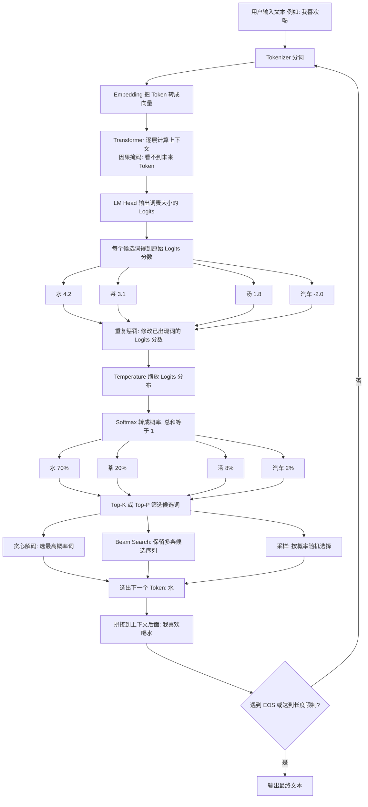

# LLM 下一个 Token 预测整体链路

> 图下方是配套说明，面试可对照口述。

## 关键说明

1. **循环回到 Tokenizer，不是回到用户原始输入**
   每一轮送入模型的，是「旧上下文 + 刚生成的新 Token」拼接后的完整序列。

2. **后处理管道顺序（不能颠倒）**
   `Logits → 重复惩罚 → Temperature → Softmax → Top-K / Top-P → 解码`
   重复惩罚、Temperature 都是作用在**原始 Logits 分数**上，Softmax 才是把分数变成概率。

3. **Temperature 的作用**
   `Logits / T` 再进 Softmax。T 越小，指数后差距被放大，概率集中在头部，输出稳定；T 越大，分布越平缓，输出更随机。

4. **KV-Cache（工程优化，图上未画）**
   缓存历史 Token 的 K/V，循环时只计算新增 Token，不重算全部历史，长文本推理提速的关键。

5. **Beam Search（图上为教学简化）**
   真实实现是同时维护 N 条完整候选序列，逐步扩展、最后择优，不是单步只输出一个 Token。

6. **训练 vs 推理**
   本图是推理流程，所有权重固定不变；训练阶段会计算 Loss 并反向传播更新 Embedding / Transformer / LM Head 的权重。

## 三种解码策略对比

| 策略 | 做法 | 特点 |
| --- | --- | --- |
| 贪心 Greedy | 每步取概率最高 | 确定性强、易重复、缺乏多样性 |
| Beam Search | 保留 N 条候选序列 | 质量较稳，计算开销大，偏「翻译/摘要」 |
| 采样 Sampling | 按概率分布随机抽 | 有创造性，配合 Temperature / Top-P 控制发散度 |

> （注：部分内容由豆包 AI 生成）